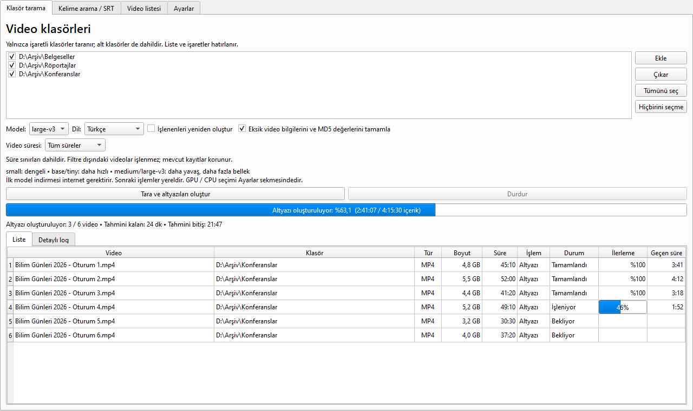
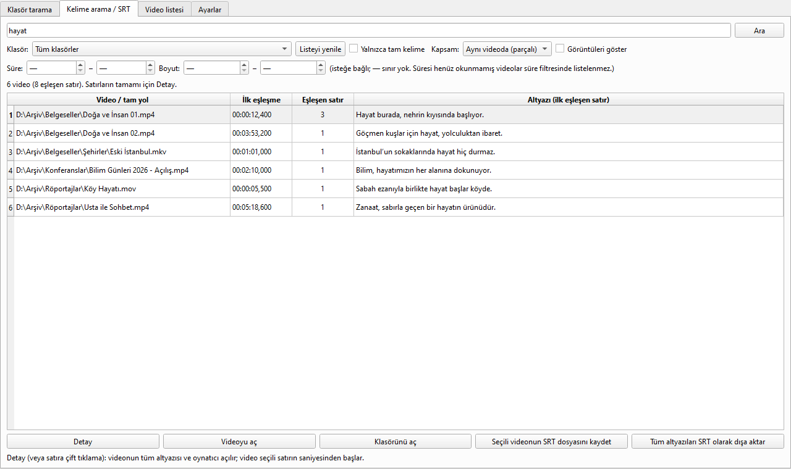
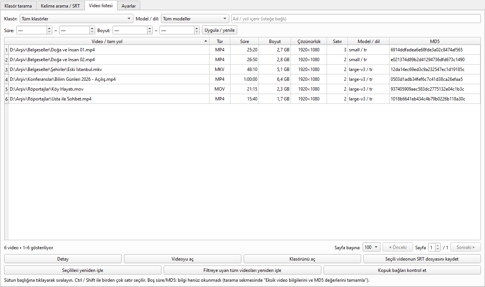
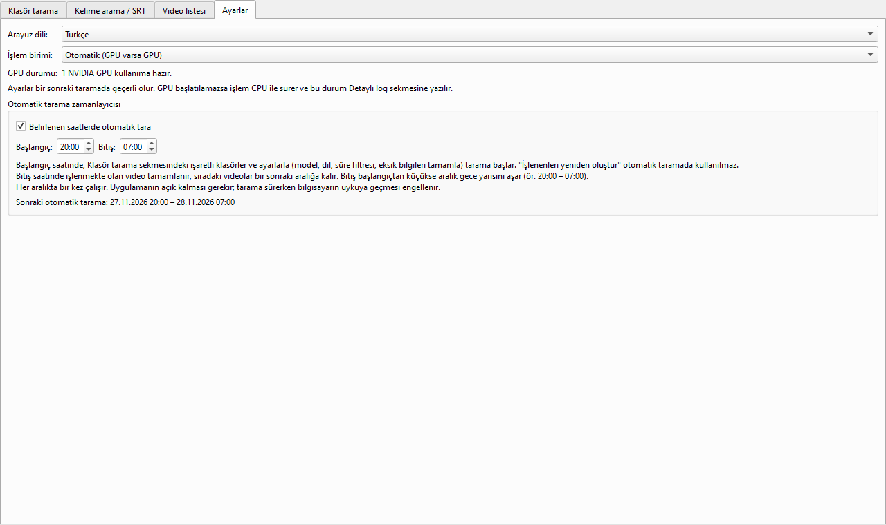

# Videoda Kelime Ara

Türkçe | [English](README.en.md)

Klasörlerdeki videoların konuşmasından altyazı çıkarır (faster-whisper), SQLite'a kaydeder ve tüm arşivde kelime araması yapar. Arayüz Türkçe ve İngilizce kullanılabilir (Ayarlar → Arayüz dili; değişince program yeniden açılır, ilk açılışta Windows diline göre seçilir).

## Ekran görüntüleri

| Klasör tarama | Kelime arama |
|---|---|
|  |  |
| **Video listesi** | **Ayarlar ve zamanlayıcı** |
|  |  |

Görüntüler örnek verilerle alınmıştır (`tools/ekran_goruntusu.py`).

## Kurulum ve çalıştırma

- **İlk kurulum:** `kurulum.bat` — Python sanal ortamını proje klasöründe `.venv` içine kurar; NVIDIA kart varsa GPU kütüphanelerini (`requirements-gpu.txt`) de ekler. Başka bilgisayarda bozuk `.venv` algılanıp yeniden kurulur.
- **Açma:** `baslat.bat` (`.venv\Scripts\python.exe main.py`).
- **Güncelleme:** `guncelle.bat` — paketleri günceller; `veriler` ve `modeller` korunur.

Başka bilgisayarda kullanmak için proje klasörünü (`veriler` ve `modeller` dahil) kopyalayıp `kurulum.bat` çalıştırın. Video yollarının o bilgisayardan erişilebilir olması gerekir. Veritabanını yalnızca uygulama kapalıyken kopyalayın.

### Klasör yapısı

```text
main.py            uygulama başlangıcı
arsiv/             program kodu (arayuz, isci, veritabani, konusma, zamanlayici ...)
tests/             birim testleri
varliklar/         simge
veriler/           altyazilar.sqlite3, ayarlar.ini, onizlemeler/ (sürümlenmez)
modeller/          indirilen konuşma tanıma modelleri (sürümlenmez)
```

## Kullanım
1. **Ekle** / **Çıkar** ile klasör listesini düzenleyin, bu taramada istediklerinizi işaretleyin. Alt klasörler otomatik taranır; başka bir klasörün altında kalan klasör iki kez gezilmez. Çıkarmak yalnızca listeden çıkarır, kayıtlı altyazılar kalır.
2. Model ve dili seçip **Tara ve altyazıları oluştur** düğmesine basın.
3. **Kelime arama / SRT** sekmesinde kayıtlı tüm videolarda kelime arayın.
4. Sonuçlarda her video bir kez listelenir: video yolu, ilk eşleşmenin zamanı, eşleşen satır sayısı ve ilk eşleşen satır görünür (fare ile üzerine gelince eşleşen satırlar listelenir). **Görüntüleri göster** açıkken her videonun ilk eşleşme saniyesindeki kare arka planda üretilir (video başına ~0,3–0,7 sn, önce ekranda görünen satırlar) ve `veriler/onizlemeler` klasöründe saklanır (görüntü başına ~6–13 KB); aynı arama tekrarlandığında anında gelir. Video değişirse görüntü yeniden üretilir. Bu klasör silinebilir, gerektiğinde yeniden oluşur. **Detay** düğmesi (veya satıra çift tıklama) videonun tüm altyazısını ve gömülü oynatıcıyı açar; video seçili satırın saniyesinden başlar, listedeki herhangi bir satıra tıklayınca o saniyeye gider. Aranan kelimeleri içeren satırlar sarı gösterilir. Aynı pencereden VLC'de o saniyeden açma (VLC kuruluysa), varsayılan oynatıcıda açma, metni kopyalama ve SRT kaydetme yapılabilir. **Videoyu aç** düğmesi varsayılan oynatıcıyı baştan açar.
5. Seçili videoyu veya tüm arşivi SRT olarak dışa aktarabilirsiniz. Toplu dışa aktarma dosyalarına benzersiz veritabanı kimliği eklenir.
6. **Video listesi** sekmesi arama yapmadan tüm kayıtlı videoları sayfa sayfa gösterir (sayfa başına 50/100/200/500): yol, tür, süre, boyut, çözünürlük, altyazı satır sayısı, model/dil ve MD5. Sütun başlığına tıklayınca o sütuna göre sıralanır (ikinci tıklama ters sıralar). Klasör, ad/yol, süre ve boyut ile isteğe bağlı daraltılabilir. Detay, video açma, klasör açma ve SRT kaydetme buradan da yapılır.

### Tarama ilerlemesi, silinen dosyalar ve video bilgileri

- Tarama önce klasörleri listeler, sonra hangi videoların **gerçekten** işleneceğini belirler. İlerleme çubuğu ve `[x/y]` sayacı yalnızca işlenecek videoları sayar (ör. `31241 video bulundu: 26722 önceden işlenmiş, 4519 işlenecek.`); yüzde de buna göre gösterilir. Seçilen model/dil kayıttakinden farklıysa video yeniden işlenecek sayılır.
- Taranan klasörlerde kaydı olup diskte bulunmayan video, başka bir yerde **aynı MD5** ile (MD5 yoksa **aynı boyut ve tarih** ile) bulunursa bağı otomatik düzeltilir: altyazı korunur, yeniden işlenmez. Eşleşmeyen kayıtlar artık otomatik silinmez, sonuçta kopuk kayıt olarak bildirilir.
- **Video listesi > Kopuk bağları kontrol et** tüm kayıtları denetler ve yeni yer önerir (yeşil öneriler kesin eşleşmedir). Seçili satırlar için: **Önerileri uygula**, **Dosyayı elle seç**, **Başka klasörde ara**, **Kayıttan kaldır**. Kaldırmak altyazıyı da siler; video dosyasına hiçbir işlem yapılmaz.
- Yeni işlenen her videonun süresi, türü (uzantı), boyutu, çözünürlüğü/codec'i ve MD5 değeri `videos` tablosuna kaydedilir. **Eksik video bilgilerini ve MD5 değerlerini tamamla** açıkken (varsayılan) altyazı işinden sonra önceden işlenmiş videoların eksikleri tamamlanır: önce hızlı olan süre/çözünürlük, ardından dosyanın tamamını okuyan MD5. Büyük arşivde MD5 uzun sürebilir; durdurulursa sonraki taramada kalan yerden devam eder. Eski veritabanı ilk açılışta yeni sütunlarla otomatik güncellenir (tür hemen doldurulur).

### Liste ve Detaylı log

Tarama sekmesinin altındaki **Liste** bu işlemde işlenecek videoların tamamını baştan gösterir: tür, boyut, süre, işlem, durum (Bekliyor, İşleniyor, Tamamlandı, Hata…), ilerleme yüzdesi ve geçen süre; Klasör sütunu videonun yerini gösterir. Liste işlenen videoyu takip eder. Süreler altyazı işinden önce paralel okunur (**Video süreleri okunuyor** aşaması).

Altyazı aşamasında ilerleme video adedine değil, işlenen içerik süresine göredir. Tahmini kalan ve bitiş bu işlemdeki ortalama hızdan hesaplanır, ilk ölçümden 30 saniye sonra görünür. Konuşması az uzun videolar çok daha hızlı işlendiği için tahmin dalgalanabilir. Hata nedenini görmek için fareyi Durum hücresine getirin. **Detaylı log** eski günlük ekranıdır.

### Toplu yeniden işleme

**Video listesi** sekmesinde **Model / dil** filtresiyle (ör. `small / tr`) videoları süzün. **Seçilileri yeniden işle** (Ctrl / Shift ile seçim) veya **Filtreye uyan tüm videoları yeniden işle** düğmesi model ve dil sorar. Eski altyazı, yenisi kaydedilene kadar korunur.

### GPU / CPU

**Ayarlar** sekmesinden işlem birimi seçilir: Otomatik (varsayılan), GPU (NVIDIA CUDA) veya CPU. GPU başlatılamazsa işlem CPU ile sürer ve neden Detaylı log'a yazılır. GPU için gereken CUDA 12 kütüphaneleri (`nvidia-cublas-cu12`, `nvidia-cudnn-cu12`) `kurulum.bat` tarafından `.venv` içine kurulur; ayrıca CUDA kurmak gerekmez.

### Otomatik tarama zamanlayıcısı

**Ayarlar** sekmesinde **Belirlenen saatlerde otomatik tara** işaretlenip başlangıç ve bitiş saati girilir (ör. 20:00 – 07:00; bitiş başlangıçtan küçükse aralık gece yarısını aşar). Başlangıç saatinde Klasör tarama sekmesindeki işaretli klasörler ve ayarlarla tarama başlar; "İşlenenleri yeniden oluştur" otomatik taramada kullanılmaz. Bitiş saatinde işlenmekte olan video tamamlanır ve kaydedilir, sıradakiler bir sonraki aralıkta işlenir. Her aralıkta bir kez çalışır; elle durdurulursa o aralıkta yeniden başlamaz. Uygulama aralık içinde açılırsa tarama hemen başlar. Uygulamanın açık kalması gerekir; tarama sürerken Windows'un uykuya geçmesi engellenir (ekran kapanabilir).

### Arama filtreleri

Arama sekmesindeki **Süre** (dakika) ve **Boyut** (MB) alanlarına alt ve/veya üst sınır girilebilir; `—` o tarafta sınır olmadığı anlamına gelir, sınırlar dahildir. Süre filtresi açıkken süresi henüz okunmamış videolar listelenmez.

### Video süresi filtresi

Tarama sekmesindeki **Video süresi** alanını kullanın:

- **Tüm süreler:** Süre sınırlaması yoktur (varsayılan).
- **En fazla (≤):** Örneğin 10 dk; yalnızca 10 dakika ve altı işlenir.
- **En az (≥):** Örneğin 5 dk; yalnızca 5 dakika ve üstü işlenir.
- **İki süre arasında:** Örneğin 2–10 dk; iki sınır da dahildir.

Ondalıklı dakika girilebilir. Süre, konuşma modeli çalıştırılmadan önce video
bilgilerinden okunur; video kırpılmaz. Filtre açıkken süresi okunamayan dosya
hata günlüğüne yazılır ve işlenmez. Süre nedeniyle atlananların sayısı sonuçta
gösterilir. Mevcut SQL kayıtları silinmez ve arama tüm kayıtları kapsamaya devam eder.
Model, dil ve süre filtresi seçimleri hatırlanır.

SQLite veritabanı: `veriler/altyazilar.sqlite3`. `videos` tablosu dosyaları, `segments` zamanlı metinleri, FTS5 `search_index` kelime indeksini tutar. SQL sunucusu gerekmez. Veritabanını yedeklemek için uygulama kapalıyken bu dosyayı kopyalayın.

Arama büyük/küçük harf ve Türkçe karakter duyarsızdır: `dusunurse`, `DÜŞÜNÜRSE` ve `düşünürse` aynı sonuçları verir (ı/i, ş/s, ç/c, ğ/g, ö/o, ü/u eşleşir). Varsayılan olarak kelime başı eşleşir (`hayat` → `hayatımız`); **Yalnızca tam kelime** kutusu ekli halleri dışarıda bırakır. **Klasör** listesinde taranmış ana klasörlerden bir veya birkaçı işaretlenerek arama yalnızca bu klasörlerin altındaki videolarla sınırlanabilir; hiçbiri işaretli değilse (veya **Tüm klasörler** seçilirse) tüm arşivde aranır. Birden fazla kelimede **Kapsam** seçilir: **Aynı videoda (parçalı)** (varsayılan) her kelimeyi ayrı arar, hepsinin geçtiği videolardaki ilgili satırları listeler (`birine mi muhtaç` → üç kelimenin de geçtiği videolar); **Aynı satırda** tüm kelimelerin aynı altyazı satırında olmasını ister. Yeni sürüm ilk açılışta arama indeksini bir kez yeniden oluşturur (birkaç saniye). En fazla 1000 sonuç gösterilir.

İşlenen ve değişmeyen videolar aynı model/dil ile tekrar taranırsa atlanır. Durdurma segmentler arasında yapılır; indirme ve ses çözümleme sırasında gecikebilir. Tamamlanmamış video bir sonraki taramada baştan işlenir. Hatalar günlüğe yazılır ve diğer videolara devam edilir. Yeniden işlem başarılı olana kadar önceki altyazı korunur.

Konuşmadan otomatik altyazı üretmek için faster-whisper kullanılır; videoya gömülü mevcut altyazı kanalları çıkarılmaz. Konuşma tanıma hataları olabilir. İlk model kullanımında internetten model indirilir (`modeller`); video dosyaları bir servise gönderilmez. CPU'da int8, GPU'da float16 ile çalışır. Uzun arşivler donanıma göre saatler sürebilir. PyAV ses çözümleyicisi paketlerle gelir; ayrıca FFmpeg kurulumu gerekmez.

Proje ve veritabanı ağ sürücüsündeyse bağlantı kesintileri işlemi etkileyebilir. Aynı anda yalnızca bir uygulama örneği açılır.

## Testler

```
.venv\Scripts\python.exe -m unittest discover -s tests -v
```

Testler gerçek model indirmez; konuşma tanıma sahte modelle, veritabanı geçici dosyayla denenir.

## Lisans

MIT — ayrıntılar [LICENSE](LICENSE) dosyasında. Konuşma tanıma motoru: [faster-whisper](https://github.com/SYSTRAN/faster-whisper).
